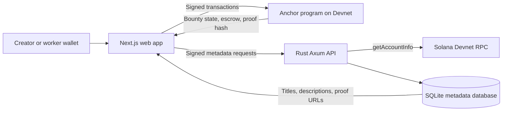

# Solana Bounty Board

A Devnet bounty board for funding small tasks and paying contributors on Solana. The project combines an Anchor program written in Rust, a Rust API, and a Next.js wallet-enabled web app.

> **Network:** Solana Devnet. This is a learning and demonstration project, not a production service. Do not use it with mainnet funds.

## Project overview

A creator defines and funds a bounty in SOL. A worker submits a public proof link. The creator reviews the work and, if satisfied, approves the bounty so the program pays the worker from escrow.

Solana stores the bounty's creator, worker, reward, deadline, proof-link hash, and status. The API stores display metadata that is not part of the on-chain account: the bounty title, description, and proof URL. The proof URL is hashed with SHA-256, and that hash is recorded on-chain when work is submitted.

## Features

- Create a bounty with a positive SOL reward and a future deadline.
- Keep the reward in the bounty program account while the bounty is open or submitted.
- Submit work before the deadline from a wallet other than the creator.
- Record the submitter and SHA-256 hash of the proof URL on-chain.
- Let only the bounty creator approve a submission and pay the recorded worker.
- Let the creator refund an expired bounty when it is still open and has no submission.
- Browse bounty status from Solana and load titles, descriptions, and proof links from the Rust API.
- Require wallet-signed requests for API writes that save bounty details or proof links.

## Technology

| Layer | Technology |
| --- | --- |
| On-chain program | Rust, Anchor |
| Web app | Next.js, React, TypeScript, Solana Wallet Adapter |
| API | Rust, Axum, SQLx |
| Local metadata storage | SQLite |
| Network | Solana Devnet |

## Architecture



The app reads bounty accounts directly from the program and joins them with API metadata. The API also reads the referenced bounty account from Devnet before accepting metadata, then checks the creator or worker against on-chain state.

## Bounty lifecycle

```text
Open ── worker submits before deadline ──> Submitted ── creator approves ──> Paid
  └── deadline passes with no submission ── creator refunds ──> Refunded
```

The current program has no reject, dispute, or resubmission instruction. A submitted bounty can be approved and paid; the expired-bounty refund is available only while its status is still `Open`.

## On-chain program

- **Program ID:** `DMqKGbqScoY1vUAf5ZHos4LDxFUmtbhai7zpAKUUKJX8`
- **Cluster:** Devnet
- **Explorer:** [View the program on Solana Explorer](https://explorer.solana.com/address/DMqKGbqScoY1vUAf5ZHos4LDxFUmtbhai7zpAKUUKJX8?cluster=devnet)
- **Account PDA seeds:** `b"bounty"`, creator public key, and the bounty ID encoded as little-endian `u64`.

The `Bounty` account stores:

- `id`: unique `u64` chosen by the client
- `creator`: wallet that funded the bounty
- `worker`: wallet that submitted work, or the default public key before submission
- `reward_lamports`: escrowed reward in lamports (`1 SOL = 1,000,000,000 lamports`)
- `deadline`: Unix timestamp in seconds
- `submission_hash`: 32-byte SHA-256 hash of the submitted proof URL
- `status`: `Open`, `Submitted`, `Paid`, or `Refunded`

### Program instructions

| Instruction | Behavior |
| --- | --- |
| `create_bounty(id, reward_lamports, deadline)` | Requires a positive reward and a future deadline. Creates the PDA, transfers the reward into it, and sets status to `Open`. |
| `submit_work(submission_hash)` | Requires an open, unexpired bounty and a worker other than the creator. Stores the worker and hash, then sets status to `Submitted`. |
| `approve_bounty()` | Requires the creator, a `Submitted` bounty, and the recorded worker. Transfers the reward to the worker and sets status to `Paid`. |
| `refund_bounty()` | Requires the creator, an `Open` bounty, and an elapsed deadline. Returns the reward to the creator and sets status to `Refunded`. |

Payout and refund preserve the account's rent-exempt balance. The program account is not closed by these instructions.

## Backend API

The API listens on `127.0.0.1:8080` in the current local setup. It defaults to the public Solana Devnet RPC endpoint. Its SQLite file is created relative to the backend's working directory as `backend/bounty_board.db`; this local database is ignored by Git.

### Endpoints

| Method | Route | Description | Authentication |
| --- | --- | --- | --- |
| `GET` | `/health` | Returns `ok` when the API is running. | None |
| `GET` | `/api/bounties` | Lists saved bounty titles and descriptions. | None |
| `GET` | `/api/bounties/{address}` | Returns metadata and saved submissions for a bounty. | None |
| `POST` | `/api/bounties` | Saves or updates a bounty's title and description. | Creator wallet signature required |
| `POST` | `/api/bounties/{address}/submissions` | Saves a proof URL and its hash. | Submitting worker's wallet signature required |

### Signed API writes

Before a write, the web app asks the connected wallet to sign a message. The signed message binds the request method and path, wallet address, timestamp, one-time nonce, and SHA-256 hash of the exact HTTP request body. The API verifies the Ed25519 signature, rejects signatures outside its five-minute time window and reused nonces, and checks that the signer matches the creator or worker recorded on-chain. The API also verifies that the stored proof URL hashes to the value submitted on-chain.

Signing the API message is not a Solana transaction and does not transfer SOL. The following on-chain action, such as funding a bounty or submitting work, is a separate wallet transaction and may require a Devnet fee or escrowed reward.

Unsigned writes are rejected with `401 Unauthorized`. Reads are public.

## Repository layout

```text
.
├── Anchor.toml
├── programs/
│   └── bounty-board/       # Anchor program and instruction handlers
├── backend/
│   ├── src/main.rs         # Axum API, SQLite storage, RPC checks, signature verification
│   └── Cargo.toml
└── app/
    ├── app/                # Next.js pages, wallet providers, and styles
    ├── idl/                # Generated Anchor IDL and TypeScript type
    └── package.json
```

## Prerequisites

Install these tools in a Linux or WSL development environment:

- Rust toolchain `1.89.0` (pinned in `rust-toolchain.toml`)
- Solana CLI
- Anchor CLI (the project was initialized with Anchor CLI `1.1.2`)
- Node.js and npm
- Phantom or another Solana wallet that supports message signing

The commands below use `/path/to/Solana-Bounty-Board` as a placeholder. Replace it with the directory where you cloned this repository.

## Run locally

### 1. Start the Rust API

In a WSL terminal:

```bash
cd /path/to/Solana-Bounty-Board/backend
cargo run
```

Keep this terminal open. The API should log that it is listening at `127.0.0.1:8080`. Verify it in a browser at [http://localhost:8080/health](http://localhost:8080/health); the response should be `ok`.

Optional API setting:

```bash
export BOUNTY_RPC_URL=https://api.devnet.solana.com
```

The default is already Devnet. Set this before `cargo run` only if you need to select another Solana RPC endpoint.

### 2. Start the Next.js app

In a second WSL terminal:

```bash
cd /path/to/Solana-Bounty-Board/app
npm ci
npm run dev
```

Open [http://localhost:3000](http://localhost:3000). The API URL defaults to `http://localhost:8080`. To override it, set `NEXT_PUBLIC_API_URL` before starting Next.js, for example:

```bash
export NEXT_PUBLIC_API_URL=http://localhost:8080
npm run dev
```

### 3. Connect a Devnet wallet

1. Set the wallet to Solana Devnet/Testnet mode.
2. Fund the wallet with Devnet SOL from a faucet.
3. Connect the wallet to the app.
4. Create a bounty, submit work from a different wallet, and approve it from the creator wallet.

Wallets need Devnet SOL for transaction fees. The creator also needs enough for the reward and bounty account rent. A worker needs a small amount for their submission transaction fee.

## Build and deploy the program

From the repository root:

```bash
anchor build
```

To deploy or upgrade on Devnet, make sure the configured Solana keypair has Devnet SOL, then run:

```bash
anchor deploy --provider.cluster devnet
```

The program ID in `programs/bounty-board/src/lib.rs` must remain consistent with the deployed program and the IDL used by the app. Redeploying program code changes on-chain behavior; review the Anchor instructions and account constraints before upgrading.

## Verification performed

The Devnet demo flow has been exercised with separate creator and worker wallets:

- Create and fund a bounty
- Sign and save bounty metadata through the API
- Submit work from a second wallet
- Sign and save proof metadata through the API
- Approve the submission and pay the worker
- Send an unsigned API write and confirm the API responds with `401 Unauthorized`

## Known limitations and production notes

- This is a Devnet prototype. It is not audited and must not be treated as production-ready or used with mainnet funds.
- The API currently binds to localhost, allows only the local Next.js origin, and stores metadata in a local SQLite file. It is not publicly hosted or configured for multi-instance production use.
- The title, description, and proof URL are API/SQLite metadata, not on-chain data. The proof URL hash is on-chain; the linked content itself is not uploaded or verified by this project.
- Public API reads do not require authentication. Write signatures authenticate the creator or worker for metadata writes, but do not replace HTTPS, rate limiting, deployment hardening, monitoring, or a security audit.
- There is no reject, dispute, or resubmission flow for submitted work. A bounty that reaches `Submitted` cannot use the current open-bounty refund instruction.
- The API uses a public Devnet RPC by default. Public deployments should use an appropriately configured RPC endpoint and persistent storage.

## License

No license has been added yet. All rights reserved unless a license is added to this repository.
